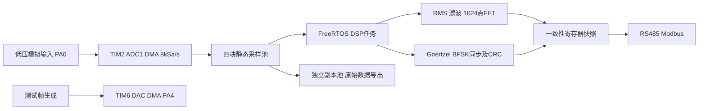

# SignalNode 实现设计

本版把BFSK纳入正式功能，目标平台为C + STM32F407 SPL + FreeRTOS。频谱与通信解码共用采样源，接收机使用滤波前的原始输入，避免频谱设置中的低通误伤1500Hz音调。

## 数据链

## 调度与所有权

| 单元 | 优先级 | 行为 |
|---|---:|---|
| ADC DMA、USART2、TIM5 IRQ | NVIC 6 | 固定复制/接收组帧，调用FromISR；不做FFT/打印 |
| DAC DMA、串口TX DMA IRQ | NVIC 7 | 有界发送缓冲补充、完成通知 |
| DSP+BFSK任务 | 4 | 采样消费、通信判决、频谱、发布与归还采样块 |
| Modbus任务 | 3 | 协议校验、寄存器访问、等待USART真正发送完成 |
| 原始导出任务 | 2 | UART DMA异步发送，发送结束归还副本 |
| 监测任务 | 1 | DWT/栈水位、进度看门狗、周期测试帧 |

任务数值越大优先级越高；NVIC越小越紧迫，两者分开配置。允许FromISR的NVIC边界为5，外设IRQ均满足。PendSV/SysTick由内核管理，FPU高寄存器上下文由CM4F端口按需保存。

ADC每64ms完成512点。ISR从空闲队列取得软件块，固定复制1024字节后投递指针；DSP消费后归还。队列满时丢新块并统计。DMA两半中断同时积压或ADC溢出时停止/上报，避免发布无法证明有效的数据；复制后再次检查该半区是否仍未被DMA回写。

64位采样索引始终按硬件完成块前进。丢块后，下一个索引缺口同时重置FFT滑窗/滤波状态与BFSK捕获。导出采用另一组缓冲，主机慢不会扣住采样池。看门狗关注采集和DSP是否持续前进，主站不在线不作为重启理由。

所有任务、队列、采样池和工作区静态分配，没有运行期malloc。实时预算仍需硬件验证，设计目标：DSP每块<10ms、ADC ISR<80us。当前只记录最大值和栈水位，没有声称已达到目标。

## 信号处理

- Fs=8000，N=1024，步长512：观测窗128ms、每64ms更新，bin间隔7.8125Hz。
- 连续二阶Butterworth低通，可旁路；跨块保留状态。重叠窗口只滤新增样本。
- AC RMS在未加窗的原始/滤波后数据上分别计算。FFT支路去均值并加周期Hann或矩形窗。
- 正弦幅值用sum(w)，功率用sum(w²)归一化；频段输出为V²，不是PSD。
- CMSIS RFFT的DC/Nyquist特殊打包单独处理。固定1024点，仅编译所需三张旋转/位逆序表。
- Hann三点峰值插值改善孤立单音估计，不提高双音真实分辨能力；当前非整bin幅值未做进一步修正。
- 频谱配置在块边界应用。启用/重置滤波后，首个完整窗口标为预热无效。

标称VDDA为3.3V；真实量程必须测量。数字低通不能挽回已发生的混叠，模拟调理与抗混叠属于硬件验收。软件搜索20..2000Hz不代表模拟通带已校准。

## 通信

BFSK参数与帧格式见BFSK.md。原始采样输入直接进入两路Goertzel判决，4种相差20样点的初始时相搜索用于捕获前导和32位同步字；锁定后每80点判决一次。当前没有持续时钟跟踪，短帧容限由实验报告限定。

Modbus使用本项目新编写的C协议核心，功能码04/06/16。参考过开源HAL/FreeRTOS库的组织方式，但没有把其HAL实现移入SPL工程。广播只执行允许的写，坏CRC不执行，非法长度/地址/数据有异常响应，多寄存器写先全部校验后提交。

RS485当前固定19200 8E1。TIM5提供1MHz时基；RXNE观察的是字节结束，因此字节完成间隔的判断包含字符时间。采用t3.5加一字符的保守帧结束等待约2579us，避免字节中途切帧。DMA发送完成只表示数据写到USART，等待USART TC才释放DE。物理层/边界时序尚需逻辑分析仪核验。

独立USART1使用921600 8N1。每个原始块1046字节，15.625块/s约16.34KB/s，线速需求约163.44kbps。版本、类型、长度、32位传输序号、64位首采样索引和CRC用于检查传输连续性；CRC不提供认证。

## 与现有经历的关系

飞控项目体现闭环控制和安全状态，本项目体现连续数据流、测量定义、调制判决与设备协议。RS485/Modbus与既有现场调试经历相接，采样、窗函数、滤波和BFSK则为通信工程课程提供可验证的应用。求职主线仍为MCU/嵌入式软件。

已经实现的源码与尚未完成的硬件实测必须区分；不把库调用写成独立研发FFT，也不把同板同源时钟回环写成独立链路误码性能。
